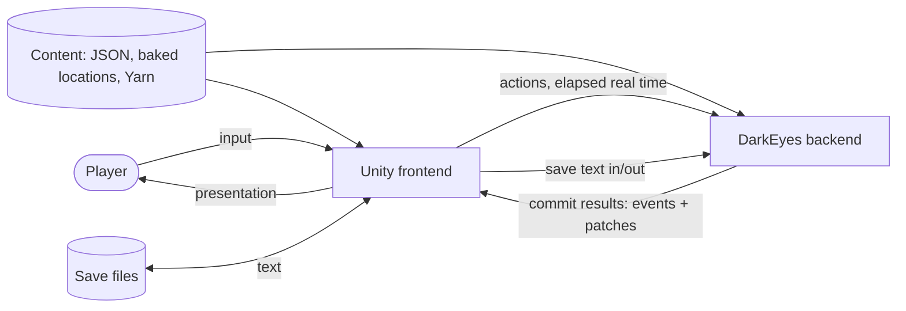
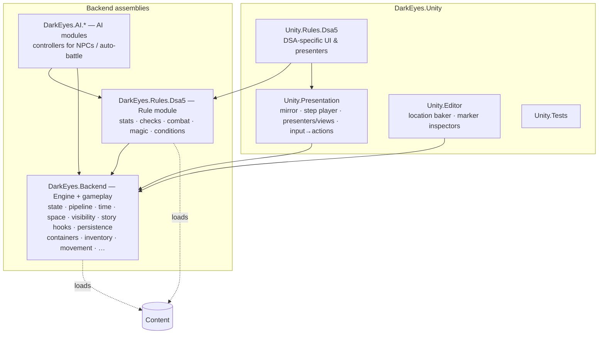
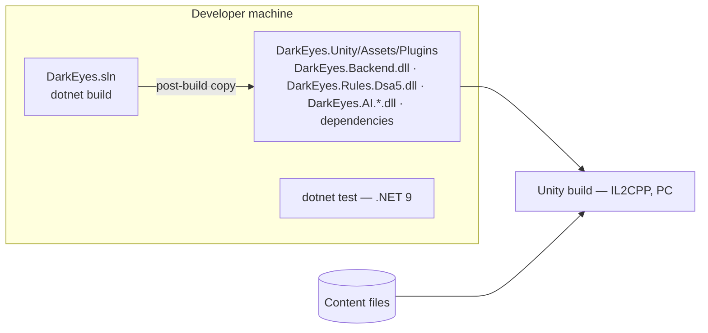

# DarkEyes — Architecture Documentation

Structure: [arc42](https://arc42.org) (sections 1–12). Decisions are recorded as compact ADRs in section 9.

> **Status:** this document describes the **target architecture**, agreed on 2026-11-08; the outcomes of the independent architecture review were incorporated on 2026-11-09. The current code (Milestone 3 + uncommitted work) implements only parts of it; section 11 lists the gaps.
> Markers used: **[decided]**, **[proposed]** (needs confirmation), **[spike]** (needs technical verification), **[open]** (not decided yet).

---

## 1. Introduction and Goals

### 1.1 Requirements overview

DarkEyes is a **single-player, party-based, tactical and strategic RPG set in Aventuria**, using the rules of *Das Schwarze Auge* 5th edition (DSA5 / The Dark Eye).

Core functional requirements:

| # | Requirement |
|---|---|
| F1 | The player controls a party of characters; the rules are as close to DSA5 as possible, with deliberate deviations allowed later. |
| F2 | Three game layers: **local exploration** (real time with pause on a location map), **tactical combat** (turn-based in rounds on the same map), **overland travel** (node-based world map). |
| F3 | Time passes at different rates (≈ real time, sped up for travel/sleep, paused) and can jump forward narratively. Timed status effects and triggers depend on game time. |
| F4 | Party inventory shared by all characters plus per-character equipment slots; access depends on the situation (e.g. combat). |
| F5 | Dialogue, quests and story beats, authored in Yarn Spinner. |
| F6 | Visibility and perception: the player only sees what the party perceives (fog of war, stealth, line of sight). |
| F7 | Save and load. |
| F8 | Multiplayer is **not planned**, but the design must not block it. |

### 1.2 Quality goals

| Priority | Quality goal | Meaning |
|---|---|---|
| 1 | **Determinism and testability** | The same state + seed + inputs always produce the same result. Game logic is fully testable with automated tests, without Unity. |
| 2 | **Separability of the rule system** | DSA5-specific mechanics can be replaced without touching the engine (a possible release would raise licensing questions). Common RPG concepts (dice, attributes, life points, initiative) may live in the engine. |
| 3 | **Consistency between backend and frontend** | The frontend can never drift from the backend's state; it contains no rule logic. |
| 4 | **Maintainability / clarity** | A Redux-like, unidirectional flow that is easy to reason about; explicit code over magic. |
| 5 | **Information hiding** | Hidden game information never reaches the frontend. |

Performance is explicitly **not** a primary goal (turn-based game), but gross waste is avoided.

### 1.3 Stakeholders

| Role | Expectation |
|---|---|
| Developer (solo, hobby) | Clear architecture, low ceremony, enjoyable to work on, reproducible tests. |
| Content author (same person) | Locations authored in the Unity editor, story in Yarn, data in JSON with schema support; early detection of broken content. |
| Player | Responsive presentation, accurate previews, DSA feel. |
| Possible future publisher/licensor | DSA5 rules and Aventurian setting content are cleanly separable. |

---

## 2. Constraints

| Constraint | Consequence |
|---|---|
| **Unity 6 (6000.3), URP, PC** as the frontend | The backend must run inside Unity's .NET runtime. |
| Backend targets **netstandard2.1** | Only C# features and BCL APIs supported there (`IsExternalInit` is polyfilled; no `required` members). |
| **IL2CPP** builds with managed code stripping | **No runtime reflection** in the backend (ADR-012). |
| Tests run on **.NET 9** (xUnit) | Must behave identically to the Unity runtime → own PRNG (ADR-015). |
| Solo hobby project | Low process overhead; decisions documented in this file and in `CLAUDE.md`. |
| DSA5 / Aventuria are third-party IP | Rules in a separate module, setting only in content (ADR-010). Licensing must be clarified before any release. |
| Code style | `.editorconfig` is binding. |

---

## 3. Context and Scope

### 3.1 Business context

- **Player** interacts only with Unity.
- **Unity frontend** presents the game, collects input and turns it into actions, reports elapsed real time, and handles files (content, saves). It contains **no rule logic**.
- **Backend** owns all game state and rules.
- **Content** (definitions, baked locations, Yarn scripts, quest metadata) is static data read by both sides; the backend receives it as text from the host.
- **Saves** are produced and consumed by the backend as text; Unity decides where they are stored.

### 3.2 Technical context

- The backend is a .NET DLL loaded **in-process** by Unity (copied into `Assets/Plugins` by a post-build step). There is no network boundary today; the interface is designed so one could be introduced (multiplayer).
- Interface (target):
  - In: `Dispatch(action)`, `AdvanceRealTime(ms)`, side-effect-free queries (previews, pathfinding), load/save.
  - Out: `IObservable<CommitResult>` (BCL interface, push).

---

## 4. Solution Strategy

| Goal / problem | Approach |
|---|---|
| Single source of truth | The backend owns one **immutable state tree** (Redux-like). |
| Unidirectional, comprehensible flow | Actions → effects → ops → new state → commit result (events + patches) → frontend. |
| Determinism | All randomness through serializable PRNG streams (one per random consumer) in the state; time only as input; IDs from a counter in the state; execution order defined by the rules, with a stable engine fallback. |
| Frontend consistency without logic duplication | Frontend keeps a **mirror** updated only by **patches** generated centrally by **diffing projections**; rule-dependent previews call backend queries. |
| Information hiding | Patches come from the observer's **projection**; events pass through the **observer view**; knowledge is ordinary state (tags/components). |
| Rule separability | **Backend** (engine + generic gameplay) + **rule module** with only the DSA5-specific mechanics (separate assembly, plug-in via registration). |
| Swappable AI | AI as **controller modules** (separate assemblies), like the player but inside the backend. |
| Real time + rounds + time jumps | Backend-owned game clock with a **scheduler** of *When + If → Then* triggers (the only time mechanism); frontend only reports real time. |
| Player decisions mid-action, saveable | Interrupted chains stored as `PendingResolution` and **re-run** from the committed state on each answer. |
| Robust Unity builds | No runtime reflection; explicit registration; source generators where code generation is needed. |
| Content quality | JSON + schema, baked locations, named anchors, automated content validation tests. |

---

## 5. Building Block View

### 5.1 Level 1 — whitebox overall system

Dependency rules **[decided]**:
- The rule module references the backend, **never the reverse** (compiler-enforced, ADR-010).
- AI modules reference the engine and the rule module; neither references an AI module (ADR-025).
- Assembly timing: the rule module is a separate assembly **from the start** (the boundary that is painful to retrofit). AI modules and `Unity.Rules.Dsa5` start as their own folder/namespace behind their interfaces and become separate assemblies once a second AI or real DSA UI exists.
- Unity references the backend DLLs; the backend never references Unity.
- DSA-specific UI lives in `Unity.Rules.Dsa5`, so it can be swapped together with the rule module.

### 5.2 Level 2 — backend: engine and gameplay (`DarkEyes.Backend`)

| Building block | Responsibility |
|---|---|
| **State** | Immutable state tree: world (global entity store, locations), party, clock & time mode, whose turn it is, scheduler (triggers), ID counter, RNG streams, story state (Yarn variables), `PendingResolution`. |
| **Entities & components** | `Entity(Id, DefId, components)`; components keyed by stable name; component registration (stable type name, visibility policy, codec); definition lookup with per-component overrides. |
| **Content** | Parses definitions, baked locations, quest metadata and story triggers from text; validation. |
| **Pipeline** | Dispatcher (single, serialized), router with registration-time preconditions, action handlers, effect handlers, transaction view, reaction queue, `Decide` + replay of pending resolutions, op application, commit result building. |
| **Time** | Game clock, time scale/mode, scheduler of *When + If → Then* triggers with registered condition types, rounds in initiative order (initiative values, ties, round duration and turn content supplied by the rule module), turn/round events, ongoing activities (including movement, one entry per cell). |
| **Space** | `GamePosition(Q, R, Level)`, `HexLayout`, maps (cells, cost, elevation, transitions, baked clearance), hexagonal footprints, pathfinding, line-of-sight geometry (integer maths), overland graph. |
| **Visibility** | `Project(state, observer)` (visible entities with effective, redacted component values, derived values, clock) and the projection diff that produces patches; observer view for events; component visibility policies. Knowledge itself is ordinary components written by rule-module effects. |
| **Controllers** | Controller interface for actors; invokes AI controllers synchronously (on their turn in rounds, via scheduler entries in real time); assigns each AI controller its own RNG stream. |
| **Story** | Runs the Yarn VM as a throw-away object per run (ADR-029; random built-ins replaced, saliency strategy explicit); `ActiveDialogue` in the state; variable storage over the state; command → effect and function → query bindings; story triggers use the common trigger mechanism. |
| **Persistence** | Snapshot ↔ JSON, format versioning (migrations once formats are stable), optional command log. |
| **Queries** | Side-effect-free read API for the frontend (previews, pathfinding, reachable area, check assessments). |
| **Gameplay** | Generic game verbs and their components, in feature folders (containers, doors, inventory, …). Uses DSA5 mechanics only through checks and, where an act needs more than a check, act-specific interfaces that the rule module registers (ADR-010). |
| **Checks** | Check service an act calls with a purpose, actor and target; generic result (succeeded/failed with degree, or not possible with the rule reason); side-effect-free **assessment** without dice (possible or why not, chance of success) for validation, previews and AI. Implemented by the rule module. |

### 5.3 Level 2 — rule module (`DarkEyes.Rules.Dsa5`)

Installs through a single registration entry point: DSA components (attributes, skills, life/astral/karma points, conditions, equipment), the check service (purpose → skill, attributes and modifiers; rolls; check events; side consequences such as blunders; assessments), act-specific rule interfaces where an act needs more than a check, DSA-specific actions and handlers (attack, parry/dodge, cast, …), effects, reaction rules (e.g. free attack / *Passierschlag*), initiative values, tie-breaking and round rules, execution order where it matters, perception (writes knowledge tags through effects), condition types for triggers, derived values (incl. party stats), Yarn functions/commands that need rules (e.g. skill checks in dialogue), DSA content schemas. Internally it may be as DSA-specific as needed (no speculative generic rule interfaces, ADR-010).

### 5.4 Level 2 — AI modules (`DarkEyes.AI.*`)

Each AI module registers one or more **controllers**. A controller is a deterministic, read-only function that picks actions and answers pending decisions for the actors assigned to it (assignment is data, per definition or faction). It draws randomness only from its own RNG stream (also for variation, e.g. choosing among equally good moves) and **never observes the rule stream**: look-ahead evaluates checks with the side-effect-free assessments, or samples outcomes on state copies whose rule stream is replaced by one forked from the AI's own stream. Whether it reads the truth or faction knowledge is up to the module. All AI behaviour (tactics, patrol, follow) lives here; several AIs can coexist and be swapped.

### 5.5 Level 2 — Unity

| Building block | Responsibility |
|---|---|
| **Mirror** | Read-only copy of the party's knowledge, updated only through patches. |
| **Step player** | Queue of commit results (including provisional steps of a pending chain); plays steps in order via presenters; skip/fast-forward applies patches without animation. |
| **Presenters** | One per event type (explicitly registered); play animations and decide when the step's patches are applied. |
| **Views** | Listen to mirror changes. Two presentation regimes: *clock-driven* in real-time exploration (interpolate from the extrapolated clock and each mover's next cell + arrival time) and *step-driven* in rounds and dialogue. |
| **Planning state** | Uncommitted player plans (never in the mirror). |
| **Input → actions** | Builds actions; uses backend queries for rule-dependent previews; sends preview paths as `PreferredPath`. |
| **Adapter** | Optional Redux-style subscription / R3 stream on top of `IObservable<CommitResult>`. |
| **Location baker** (editor) | Bakes scene geometry + markers into location JSON using the backend's format types and `HexLayout`. |

---

## 6. Runtime View

### 6.1 Reaction chain with a pending player decision

1. The player moves a hero past an enemy (one action).
2. A reaction rule detects a free attack (*Passierschlag*), queued **within the same run**. The attack roll hits.
3. The handler calls `ctx.Decide(DefenceChoice)`. No answer is recorded, so the transaction is **discarded** and `PendingResolution { Action = Move, Origin = Player, Answers = [] }` is written into the committed state. The steps so far (move, attack roll) are pushed to Unity as **provisional steps**.
4. Unity presents them and asks the player (or auto-answers).
5. The answer action appends `Parry` and **re-runs the whole chain** from the committed state. The RNG state is unchanged, so the same attack roll comes out; `Decide` now returns `Parry`, and processing continues (defence roll → damage → poison → pain level) until it completes and commits, or stops at the next decision.
6. Steps already sent are skipped; debug builds verify that the replayed steps are identical.

While a chain is pending nothing else runs (no time advance, AI or scheduler). Saving stores the committed state plus `PendingResolution`; loading re-runs the chain. The reaction queue has a depth limit; re-entrant dispatch is forbidden.

### 6.2 Time advancing in exploration

1. Unity calls `AdvanceRealTime(ms)` from its frame loop.
2. The backend converts it to game time using the time scale in the state (0 if paused or in rounds).
3. The scheduler jumps from due entry to due entry (effect ends, activity completes, a mover enters its next cell, story trigger, AI re-evaluation), each processed as a system-origin commit through the effect layer. Entries due at the same time are ordered by the rules, then by the stable fallback (priority → sequence number → ID). There is no fine stepping.
4. A cell entry lets rules react (perception, traps). A trigger that needs the player (enemy noticed, encounter, ambush) stops movement and switches the time mode (e.g. into rounds); the frontend switches from clock-driven to step-driven presentation.

### 6.3 NPC turns in rounds

When an NPC's turn starts, the engine asks the NPC's AI controller for an action and dispatches it with origin `AI`. The backend computes every NPC turn **immediately** as consecutive commits until the next player decision. Unity queues and presents them at its own pace. The backend never waits for animations.

### 6.4 Dialogue and story triggers

- A game event (e.g. `ItemPickedUp(item.sacred_relic)`) matches a story trigger (*When* event pattern, optional *If*) → the Yarn node `Relic_Found` runs to completion inside the same chain, on a fresh VM. Silent nodes set variables and run commands (→ effects). If the chain is re-run (ADR-023), the node simply runs again on a new VM.
- A dialogue node runs as a chain (ADR-029) **up to the next choice point**; all lines are events with line IDs + substitutions. The choice point is a `Decide`: the chain is pending, and steps so far are provisional. The answer is either a dialogue choice or one of the actions the rules allow during dialogue (like a combat turn, e.g. own equipment slots only). On each answer the node is re-run from its start on a fresh VM. Game time is stopped; nothing outside the dialogue runs.
- At a `<<jump>>` to another node (with no active detour) and at the end of the dialogue, the chain **commits**. Between nodes the committed state holds `ActiveDialogue { Node }`, which is plain data. Example walkthrough: a quest-giver dialogue with a persuasion check, a fate-point reroll, a silent trigger node and a scheduled failure trigger all reduce to variables, triggers and effects in the state; the VM is never persisted.

### 6.5 Load game

Unity reads the save text → the backend checks the format version (once formats are stable: migrates the JSON stepwise; before that, rejects old versions) → deserializes into a new state → re-runs a `PendingResolution` if present → sends the frontend the full projection as patches (a diff against an empty projection).

---

## 7. Deployment View

- The backend solution is built with the .NET SDK; DLLs and their dependencies are copied into Unity's Plugins folder. This step must also copy the rule module, the AI modules and every runtime dependency that Unity doesn't already provide (Yarn Spinner and its dependencies, including Google.Protobuf, which Yarn needs because compiled Yarn programs are protobuf messages; `System.Collections.Immutable`; System.Text.Json if used), and nothing that isn't needed. Shared transitive dependencies such as `System.Memory` and `System.Runtime.CompilerServices.Unsafe` may clash with copies shipped by Unity packages, and Protobuf may need a `link.xml` under IL2CPP; the dependency spike covers this. Conflicts with assemblies Unity ships itself must be checked.
- Content ships with the game (e.g. StreamingAssets); Unity reads files and hands text to the backend.
- Saves are stored where Unity decides (platform-specific path).

---

## 8. Crosscutting Concepts

### 8.1 State model (Redux)
- One immutable state tree (records + `System.Collections.Immutable`); records contain no mutable members.
- Changes only through the pipeline (actions → effects → ops). Handlers work on a **transaction view** (state + own pending ops); the transaction is applied atomically or discarded.
- Commits are final; no undo.
- Redux mapping: store = state; actions/effects = Redux actions; effect handlers = reducers; AI/scheduler/story = sagas; Unity = subscriber.

### 8.2 Change pipeline and authority
- **Actions** (player, AI): attempts by an actor; rule-checked.
- **An action is one act of one actor (or the party as a group) as the rules define it.** The backend executes exactly what was dispatched and never adds acts the actor didn't choose. An act's execution may span many steps or game time (movement steps cell by cell, ongoing activities); that is one act, not a chain. Consequences the rules impose are effects or triggers; optional responses are `Decide` for the responding actor. What counts as one act is decided by the rules, not by convenience. Composing acts (convenience, automation, standing orders, auto-answers) is the caller's job: the frontend or an AI controller sends ordinary actions, each validated and committed on its own. Composed plans are planning state: not atomic, not saved; replays stay exact because the input log holds the individual actions.
- **Effects** (scheduler, story, reactions, debug, and action outcomes): decreed changes in game terms (e.g. `Unlock(chest)`, `Damage(target, 5)`) that enforce invariants and are translated into ops.
- **Ops**: record-level writes (`SetComponent`, `AddEntity`, …).
- Authority is enforced by **entry points**: the public dispatcher accepts only actions; effects can only be submitted through the handler context.
- Every commit records its **origin** (Player, AI, Scheduler, Story, Debug). The debug entry point is not part of the public gameplay API.
- Shared preconditions are declared at registration and checked centrally.
- **Controllers** supply actions and decision answers for actors: the player via the frontend, AI modules inside the backend (ADR-025).
- **Player decisions mid-action** use `ctx.Decide(...)` and replay (ADR-023): handlers stay straight-line code; an interrupted chain is stored as `PendingResolution { Root, Origin, Answers }` and re-run from the committed state on each answer. `Root = Action | SchedulerEntry(id) | TriggerFiring(id, event) | RunNode(node)`, because scheduler, story and dialogue chains need decisions too (e.g. a trap sprung by a scheduler-driven cell entry, where the player may spend a fate point). A pending scheduler chain leaves its entry due in the committed state; the clock stays at the entry's time and the rest of the real-time chunk being processed is dropped (the command log keeps replay deterministic); the projection exposes "decision pending, time stopped" so the frontend stops extrapolating the clock. If the deciding actor is AI-controlled, `Decide` calls its controller **inline**: no suspend, no provisional steps, nothing stored in `Answers` (recomputed deterministically on re-runs).

### 8.3 Commit result, patches and events
- Commit result = ordered list of steps `(event, patches caused by it)`. While a chain is pending, its steps are pushed **provisionally**; re-runs skip steps already sent.
- Patches come from **diffing projections** (ADR-022): after each step the engine diffs the **last projection actually sent** to the observer against `Project(after, observer)`. Load, provisional steps and any desync therefore heal themselves with the next diff. The projection contains visible entities with effective, redacted component values (after definition lookup), derived values (e.g. party stats) and the clock. Granularity: entity appeared/disappeared, component replaced.
- No spurious patches: `Project` returns the stored component instance unchanged when nothing is redacted, and caches redacted views per source instance (`ConditionalWeakTable`); projected types that contain collections get value equality (records compare collections by reference). Unchanged parts are skipped by reference equality.
- **Only dirty entities are diffed:** entities touched by ops in the step, plus those whose perception changed. This is complete because every visibility change is itself an op (perception is stored state, §8.4). Derived values (party stats) are few and cheap and are recomputed every step.
- Invariant checked in integration tests: mirror after applying all patches == `Project(final state)`.
- Subscribers are notified after the commit is complete. Notification is **trampolined**: a commit dispatched during notification is delivered after the current round, so subscribers always see commits in order.

### 8.4 Visibility and perception
- The mirror holds the party's knowledge, not the truth. Entities appear/disappear in the mirror as perception changes.
- **Knowledge is ordinary state** (ADR-024): tags/components on entities (`Discovered`, `Identified`, `KnownName`, optionally `LastSeen`) and explored cells as a component of the location. Written only through effects; the rule module decides when (perception checks roll with the state's RNG during the commit). This includes what is **currently perceived** (e.g. a `Perceived` set on the observer): perception isn't line of sight (a sneaking enemy can be in view and unnoticed), so the rule module re-evaluates it after relevant events (movement, light, doors) and writes the result. The projection reads all of this and never computes perception itself, so it stays pure. Only the party is an observer for now; NPC/faction knowledge is added when an AI needs it (tags then become `{ By = [...] }`).
- Redaction is **mandatory**: patches only come from the projection, events always pass through the observer view. Every event type registers an observer-view policy next to its presenter; unregistered events are **dropped** (fail closed). State outside entities (scheduler, story variables, RNG) is hidden unless explicitly exposed. Frontend queries run against the observer's view and have no RNG access.
- Each component type has a visibility policy (public / own characters only / hidden).
- Hidden map features (secret doors, traps) are always entities.
- The engine provides line of sight and the projection; the rule module decides what is perceived.

### 8.5 Time
- Integer game clock, time scale/mode, scheduler. The scheduler is the **only time mechanism**; there is no fine stepping.
- **Triggers = When + If → Then** (ADR-026): *When* is one or more moments the scheduler can index (a game time, or an event pattern such as `TurnStarted`, `RoundEnded`, `DamageTaken`, `EnteredArea`), firing on the first; *If* is an optional condition evaluated only at that moment; *Then* is an effect or a Yarn node. Conditions are data (registered condition types such as `And`, `Or`, `ActorIs`; the rule module adds its own), so triggers are saveable without reflection. Status durations, rule reactions and story triggers all use this mechanism. **General rules** (e.g. moving past an enemy provokes a free attack) are registered in code by the rule module; **stored triggers** in the state exist only for concrete instances (this poison on this hero, a quest trigger, a scheduled event), so saves never contain copies of rule logic and rule fixes reach old saves. Recurring effects (poison damage every KR) re-arm themselves: their *Then* schedules the next trigger.
- Rounds: the engine runs rounds in initiative order and tracks whose turn it is; the rule module supplies initiative values, tie-breaking, round duration and what a turn may contain. A round is a fixed amount of game time; triggers due within a round fire at the round boundary.
- Trigger semantics: a trigger only reacts to moments **after its creation**; if its *If* is false, it stays armed for its remaining *When* moments.
- How DSA durations ("3 KR", "until the start of your next turn") map onto triggers is **rule-module implementation**, offered as builders (e.g. `Duration.Rounds(3, anchor: caster)`); content and handlers use only those. The engine provides turn/round events and the current turn; no round/turn counters in the state. DSA fidelity (e.g. whether "3 KR" ends at the round boundary or at the applier's turn) is checked when spells and conditions are implemented.
- Actions with duration in exploration become **ongoing activities**, completed by the scheduler unless interrupted. **Movement** is an ongoing activity with one scheduler entry per cell (ADR-027). In rounds, a move action steps through its path cell by cell and calls the **same cell-entry hook** (free attacks, traps, perception). What happens to ongoing activities when the mode changes (e.g. an ambush starts rounds) is a rule decision per activity type, reacting to the mode-change event.
- **Simulation scope:** only the **active location** runs movement; other locations are frozen except for their triggers. **Fast time** (resting, waiting) is only available where the rules/content say it's safe (e.g. an inn, a cleared camp, no per-cell movers nearby); overland travel is node-based and has no per-cell movers. This keeps per-cell commits at a harmless rate (about 3 per second per mover at normal speed) and avoids simulating e.g. 86,000 per-cell commits per patrolling guard during an 8-hour rest. Revisit (e.g. NPC routines as time-based schedules) if resting in dangerous places becomes a design requirement.
- Frontend extrapolates the clock for display only and has two presentation regimes (clock-driven in real time, step-driven in rounds/dialogue).
- **[open]** Trigger behaviour during narrative jumps; normal-play time ratio.

### 8.6 Entity model and content
- Definitions are static content (JSON + JSON Schema), not state; instances store only runtime state and per-component overrides.
- Global entity store; placement as a component; invariant: every entity is in exactly one place; containers list contents.
- IDs: readable content IDs for authored entities; counter in the state for runtime spawns; duplicates rejected.
- Items: stacks (definition + quantity) or instances (full entities).

### 8.7 Space
- Invisible logical hex grid under a freely designed 3D world; finer than one pace (tentatively 3 hexes per pace; one constant).
- Multi-hex footprints, **hexagonal by radius** (r0 = 1 cell, r1 = 7 cells ≈ a human at 3 hexes per pace, r2 = 19): no rotation problem. The baker precomputes **per-cell clearance**, so A* checks `clearance >= radius`; only dynamic obstacles need an occupancy check of the footprint. Reach/adjacency = centre distance minus both radii. The combat UI shows ranges and reachable areas as highlighted regions (hex grids don't nest).
- **Integer maths for anything that affects state** (distances, line of sight, areas, elevation checks); floats only for presentation.
- `Level` = discrete walkable surfaces with explicit transitions; elevation per cell.
- Locations authored in the Unity editor, baked to JSON (fingerprint for staleness, format version); one shared `HexLayout`.
- Story references named anchors only; story map requirements are validated automatically.
- Three kinds of path: logical (backend), preview (backend query → `PreferredPath`), visual (frontend smoothing). Pathfinding plans on party knowledge.
- **Party movement outside rounds:** the party moves as one group. The leader follows the `PreferredPath`; followers follow the leader's trail at their slot offsets (deterministic, no own pathfinding). Party members don't block each other; NPCs do (wait, then repath; details are implementation). In rounds every hero moves individually.
- Overland: node graph.

### 8.8 Determinism and randomness
- Own small PRNG (e.g. PCG32 / xoshiro128\*\*), identical on .NET 9 and Unity; its state lives in the state tree and in saves.
- **Separate streams per random consumer** (rule resolution, each AI controller, content such as loot and encounters, story/Yarn saliency), derived from the master seed, so a change in one consumer never shifts another's rolls.
- **An AI never observes the rule stream.** A state copy carries the real rule stream, so running real checks on it would reveal the next real rolls. Look-ahead therefore evaluates checks with the side-effect-free assessments (as previews do). An AI that wants to sample outcomes runs the pipeline on a state copy whose rule stream is replaced by a stream forked from the AI's own stream; `Decide` in such a simulation is answered inline for every actor (the player's answers assumed), and nothing from it reaches the frontend. The AI's own stream also provides variation in its decisions (e.g. choosing among equally good moves).
- **Execution order is a rule decision** (ADR-021): wherever order can affect the outcome (turn order, simultaneous triggers, several reactions to one event, area effects on several targets, several perception checks, NPCs acting at the same time, several story triggers on one event), the rules define it. Where they are silent, the engine applies a stable fallback (priority → sequence number from the state → ordinal ID). Never hash-based iteration order (.NET 9 randomizes string hashes per process, Mono/IL2CPP doesn't). Reproducibility also applies to save output, patch/event order and content loading. Components are keyed by stable name, not `Type`.
- Concrete rules: `ImmutableDictionary`/`ImmutableHashSet`/`HashSet` are for lookup only and are never enumerated where order can matter; ordered maps use `ImmutableSortedDictionary` with `StringComparer.Ordinal` (or integer keys). Comparers are always explicit and ordinal (culture-default comparison depends on the machine's locale). Sorting only with full tie-breaking (`OrderBy`/`ThenBy`; `List.Sort` is unstable). **BannedApiAnalyzers** reject `System.Random`, `DateTime.Now`, `Guid.NewGuid`, culture-default string comparison and comparer-less `Sort`. A cross-runtime golden test (.NET 9 vs IL2CPP, Q2) runs early.
- Yarn's random built-ins are replaced by versions using the state's RNG, and the line-group saliency strategy is always set explicitly (Yarn's random strategies use `System.Random`).
- No wall-clock time, no `Guid.NewGuid()`, no `System.Random` in logic.
- For replays only external inputs (actions, elapsed real time) are recorded, plus the active AI modules and versions (AI decisions are recomputed).

### 8.9 Error handling
- **Rejections.** Actions are checked before they have any effect. Rule violations (out of range, already open, locked, …) are expected and give a rejection: a stable, act-namespaced reason code (e.g. `open_container.too_far_away`) with named arguments, no state change. One rejection type for all reasons (not one type per reason); the code is an identifier, not a localization key: the frontend keeps its own mapping from codes to texts.
- **The line is the observer's projection, not the truth.** The frontend acts on what it has been sent, which can lag behind the truth (remembered knowledge, patches not yet presented). Input that refers to something in that projection but is no longer valid in the truth is a rule violation and gives a rejection: the remembered goblin has moved, the remembered chest is gone.
- **Malformed input is a bug in the caller and throws.** This is input a compliant frontend never sends: an entity absent from the last projection sent to that observer, a structurally wrong target kind, or a `Decide` answer that wasn't offered. The same applies to AI controllers. They check candidate actions with the same validation queries as the frontend, and an invalid action or answer is a bug (it is never rejected, so it can't retry forever).
- **Rejections must not leak.** Their arguments come only from what the observer knows. For example, a distance is measured to the remembered position, never to the true one. The *fact* of a rejection is information the rules themselves make visible (e.g. DSA5: "no check possible"); beyond that, a rejection is never a probe for hidden state.
- **Impossible checks reject only when chosen.** A check an actor chooses to attempt is assessed in validation, so impossibility is a rejection. A check imposed by an effect, or one later in the chain, returns "not possible" as a result and the caller turns it into an outcome; it never throws.
- **Nested rule reasons.** When an act is rejected for a rule-specific reason (e.g. a check that can't be attempted), its act-namespaced code carries the rule module's reason as a nested code with arguments (e.g. `pick_lock.not_possible` with `dsa5.attribute_too_low(attribute)`, or `dsa5.check_not_possible` if the cause is hidden). `Unity.Rules.Dsa5` maps the rule codes to texts.
- **A rejection is pure validation.** It is only valid before the action has requested a check, submitted an effect, emitted an event or called `Decide`; a rejection after that is a handler bug and throws. A rejection therefore never retracts steps already shown, including provisional ones (ADR-023), and the player never answers a question only to be told the action was invalid. Anything that goes wrong after that point is an **outcome**, reported as an event (a failed lock pick, an interrupted move).
- Multiplayer note: "malformed input throws" is a backend-internal contract. A future network boundary must turn malformed remote input into a refusal of its own instead of letting a client crash the server.
- Bugs/invariant violations: exceptions; the commit is discarded; the state stays intact. For now this **fails hard for every origin** (ADR-028). Known gap: a throwing scheduler entry stays due and blocks time; a throwing story trigger or reaction makes its triggering action fail every time. Release-build handling (e.g. quarantining only the culprit) is to be decided before any release.

### 8.10 Persistence
- Save = snapshot of runtime state (JSON) with format and content versions.
- **Until the formats are stable** (at the latest before anyone else plays): no migrations (old versions are rejected); tests use C# scenario builders. Afterwards: stepwise JSON migrations, save files as test scenarios where useful.
- Component codecs via the System.Text.Json source generator **[spike]**, handwritten as fallback. The spike also weighs how much the generator saves, since rule-module components need a custom polymorphic converter anyway.
- Optional command log since the last save for bug reports.
- Saving is technically possible at any commit boundary, including while a decision or dialogue choice is pending (committed state + `PendingResolution`); game-design save restrictions **[open]**.

### 8.11 Localization
- The backend never produces player-facing text: line IDs, reason codes and definition IDs only; Unity localizes.

### 8.12 No runtime reflection
- Explicit registration for handlers, preconditions, components, presenters, Yarn commands/functions. Compile-time source generators are allowed.

### 8.13 Testing
- xUnit, `Should_<Outcome>_When_<Condition>`, Arrange/Act/Assert; TDD preferred; test intent through the public API.
- Test scenarios via C# scenario builders; save files as scenarios once the formats are stable.
- Every integration test can check the sync invariant: mirror after all patches == `Project(final state)`. Debug builds verify that replayed pending chains reproduce the steps already sent.
- Content validation tests (definitions, references, baked maps, story map requirements).
- Planned: a pathfinding benchmark on a worst-case map; snapshot + command log replay tests.

---

## 9. Architecture Decisions

Compact ADRs (context → decision → consequences). All dated 2026-11-08 unless noted.

| ADR | Decision | Status |
|---|---|---|
| 001 | Backend is the sole owner of state and rules; Unity only presents and sends actions. | decided |
| 002 | Redux-like immutable state tree; commits are final (no undo). | decided |
| 003 | Frontend mirror synchronized by centrally generated, record-level patches; commit result = ordered `(event, patches)` steps. Patch generation: see ADR-022. | decided |
| 004 | Three-layer pipeline actions → effects → ops; authority via entry points. | decided |
| 005 | Reactions processed within the same run via a queue, stopping at pending player decisions (mechanism: ADR-023). | decided |
| 006 | Backend-owned game clock + scheduler; frontend reports real time only; absolute game-time end times. | decided |
| 007 | Rounds in initiative order run by the engine; initiative values, ties, round duration and turn content from the rule module; only backend rules switch into rounds; NPC turns computed immediately. | decided (revised 2026-11-09) |
| 008 | Entity = Id + DefId + typed components; definitions as static content with per-component overrides. | decided |
| 009 | Global entity store with placement component; exactly-one-place invariant. | decided |
| 010 | DSA5 as a separate rule-module assembly plugged in via registration; no speculative generic rule interfaces; setting only in content. The backend is this game, not a generic engine: generic gameplay lives there; only DSA5-specific mechanics go into the module. Checks are a backend concept requested by purpose; the module decides skill, modifiers and roll and returns a generic result. Act-specific rule interfaces only where an act needs more than a check; one registration entry point. | decided (revised 2026-11-09) |
| 011 | Patches from the observer's projection, events through the observer view; per-component visibility policies; redaction mandatory. | decided (revised 2026-11-09) |
| 012 | No runtime reflection in the backend (IL2CPP stripping). | decided |
| 013 | Locations authored in the Unity editor and baked to JSON; shared `HexLayout`; named anchors for story. | decided |
| 014 | Preview paths from backend query, sent back as `PreferredPath`. | decided |
| 015 | Own PRNG; RNG state in state tree and saves; separate streams per random consumer. | decided (revised 2026-11-09) |
| 016 | IDs: content IDs for authored entities, counter for spawns. | decided |
| 017 | Saves are snapshots (JSON) with format versions; migrations only once formats are stable; codecs via source generator. | decided (generator: spike; revised 2026-11-09) |
| 018 | Push via BCL `IObservable<CommitResult>`; System.Reactive removed from the backend. | decided |
| 019 | Yarn VM in the backend; Yarn is the story/quest engine; thin trigger layer. | decided (details: spike) |
| 020 | UI Toolkit for screen and world-space UI. | decided (world space: spike) |
| 021 | Execution order is a rule decision; stable engine fallback; never hash order. | decided 2026-11-09 |
| 022 | Patches by diffing projections instead of translating ops. | decided 2026-11-09 |
| 023 | Player decisions mid-action via `Decide` + replay of `PendingResolution` from the committed state; provisional steps. | decided 2026-11-09 |
| 024 | Knowledge as ordinary components/tags; projection stays pure. | decided 2026-11-09 |
| 025 | AI as swappable controller modules in their own assemblies; own RNG streams. | decided 2026-11-09 |
| 026 | Triggers as *When + If → Then* with data conditions; one mechanism for scheduler, durations, reactions and story. | decided 2026-11-09 |
| 027 | Movement as scheduler entries per cell (one cell-entry hook for real time and rounds); no fine stepping; only the active location runs movement; fast time only where safe; two frontend presentation regimes. | decided 2026-11-09 |
| 028 | Bugs fail hard for every origin for now; release-build handling decided before release. | decided 2026-11-09 |
| 029 | Dialogue nodes as replayable chains committed at node boundaries; fresh Yarn VM per run; dialogue modal like a combat turn. | decided 2026-11-09 (details: spike) |

### ADR-002 — Redux-like immutable state
- **Context:** the backend must be the single source of truth, deterministic, easy to reason about, and snapshot-able for saves and the frontend.
- **Decision:** one immutable state tree; all changes through the pipeline; commits are final.
- **Consequences:** + snapshots/saves/replays are cheap and safe; + no partial state on failure. − nested updates are more verbose; − `System.Collections.Immutable` is needed; − the current mutable code must be migrated.

### ADR-003 — Patches instead of shared state or client reducers
- **Context:** the frontend needs a local, read-only view of the state; applying semantic events with client-side logic would duplicate rules and risk drift.
- **Decision:** the backend generates record-level patches centrally (by projection diff, ADR-022); the frontend applies them mechanically; events are only for presentation.
- **Consequences:** + no rule logic in the frontend; + works across a network. − the patch format is an interface to maintain; − derived values must be computed by the backend (they are part of the projection).

### ADR-004 — Actions / effects / ops
- **Context:** changes come from sources with different authority (player, AI, scheduler, story, reactions, debug).
- **Decision:** actors enter at actions (rule-checked), backend sources at effects (decreed, invariant-enforcing); everything compiles to ops.
- **Consequences:** + one write path; + story and scheduler reuse the same effects as actions; + authority enforced structurally. − more types (action, effect, handler per change kind).

### ADR-006 — Backend-owned time with scheduler
- **Context:** real time with pause, sped-up time, rounds and narrative jumps; timed effects must be decided by the backend.
- **Decision:** integer game clock and time mode in the state; the frontend only reports real time; a scheduler jumps between due entries; absolute game-time end times.
- **Consequences:** + deterministic; + long periods are cheap; + pausing/scaling never invalidates entries. − movement becomes many small scheduler entries (one per cell, ADR-027); − the frontend needs clock extrapolation.

### ADR-009 — Global entity store
- **Context:** party members and item instances move between locations and containers; per-location stores risk dangling references.
- **Decision:** one global store; placement is a component; exactly-one-place invariant; containers list contents.
- **Consequences:** + references are always resolvable; + moving is a component change. − patches need filtering by location/perception (needed anyway for visibility); − everything stays in memory (acceptable at the expected scale; saves can be partitioned later).

### ADR-010 — Rule module as separate assembly
- **Context:** DSA5 rules may need to be replaced if the game is ever released.
- **Decision:** the backend is this game, not a generic engine; the separation exists only to make trademarked mechanics replaceable. Backend and rule module are separate assemblies; the rule module plugs in via registration; setting content only in content files. Generic gameplay lives in the backend: containers, doors, inventory, movement, dialogue, and common RPG concepts (dice, attributes, life points, initiative-ordered rounds, checks as a concept) under generic names. Only DSA5-specific mechanics (3d20 check, quality levels, formulas, tables, special abilities, spells, terminology) live in the module. **Checks are a backend concept.** An act requests a check by its *purpose* (what is attempted, e.g. picking this lock), naming the actor and the target; the rule module decides everything else: which skill and attributes apply, all modifiers (derived from the state: actor, target, surroundings), rolling from the rule stream, player choices via `Decide` (e.g. rerolls; a check runs in the context of the chain that requests it, from an action or an effect such as a trap or a dialogue skill check), the check's own event, and rule-specific side consequences (e.g. blunders). The caller receives a generic result: **succeeded** or **failed** (with degree), or **not possible** (with the rule reason). It decides what the result means for its own outcome; the result type forces it to handle every case. `Roll` never throws for impossibility. The check service also offers a side-effect-free **assessment** without dice: whether the check may be attempted (if not, a rule-module reason with arguments; in DSA5 no check is possible once a modifier lowers an attribute to 0 or below) and the chance of success. Acts call it during validation and reject with an act-namespaced code carrying the rule reason; previews and AI look-ahead use the same assessment. For a check an actor chooses to attempt, impossibility found in validation is a rejection (DSA-faithful: the check can't be attempted). Checks imposed by effects (a trap, resisting a poison, a dialogue check) can't reject, and neither can checks later in an act's chain (§8.9): for them "not possible" is an outcome. Usually it's treated like a failure (you can't resist what you can't check against); a dialogue check writes it into its Yarn variable so the node can branch. For the frontend, the reason's arguments and the shown chance use only what the observer knows: a cause from hidden modifiers gives a reason without details, and the chance is then an estimate. **Act-specific rule interfaces** exist only where an act needs more than a check, and are shaped by current needs (no speculative generic rule interfaces). The rule module plugs in through **a single registration entry point** that installs all its mechanics. No alternative test rule module is needed.
- **Consequences:** + the boundary is compiler-enforced; + replacing DSA5 means rewriting only the trademarked mechanics, not the game; + generic gameplay doesn't pay for an indirection. − deciding whether a mechanic is DSA-specific takes discipline; + most acts need no rule interface of their own, only check purposes. − the check service and the remaining rule interfaces reflect DSA5's shape, so a replacement module may need to adapt some of them; − DSA5 extended checks (quality levels collected over several attempts) may not fit "one check, one result"; decided when the first one comes up.

### ADR-012 — No runtime reflection
- **Context:** IL2CPP managed code stripping removes code reached only via reflection; failures only appear in built games.
- **Decision:** explicit registration everywhere; compile-time source generators allowed.
- **Consequences:** + robust in any host. − a registration line per handler/component/presenter.

### ADR-017 — Snapshot saves with migrations
- **Context:** saves must survive format and content changes; IL2CPP excludes reflection-based serializers.
- **Decision:** JSON snapshots with format and content versions, component codecs via the System.Text.Json source generator (pending spike). Stepwise JSON migrations and save files as test scenarios only once the formats are stable; until then old versions are rejected and tests use C# scenario builders.
- **Consequences:** + readable, diffable, later usable as test scenarios; + no migration overhead while formats change weekly. − migrations must be written once formats are stable; − dependency risk in Unity (spike).

### ADR-019 — Yarn as the story and quest engine
- **Context:** the developer chose Yarn to avoid building a story/quest engine; Yarn only runs when a node is started.
- **Decision:** the Yarn VM runs in the backend; quest logic lives in Yarn; the engine provides variable storage over the state, commands → effects, functions → queries, and a data-driven trigger layer (event/time → node).
- **Dialogue checks:** Yarn functions are side-effect-free and commands return nothing, so a skill check in dialogue is a command whose effect rolls (rules RNG) and writes the result into a Yarn variable synchronously, inside the transaction, **before** the VM continues.
- **Determinism:** Yarn's random built-ins are replaced by versions using the state's RNG; the saliency strategy is set explicitly; the VM is never state (ADR-029); Yarn scripts are compiled at build/content time (pipeline to be documented).
- **Consequences:** + no custom quest system. − the Yarn VM is mutable and can't be snapshotted mid-node, which ADR-029 works around by re-running nodes on fresh VMs; − details need verification (spike).

### ADR-029 — Dialogue nodes as replayable chains; the Yarn VM is never state
- **Context:** the Yarn `Dialogue` VM holds a mutable position (node, instruction pointer, options) with no snapshot/restore API. A long-lived VM breaks replay (ADR-023: a silent node run twice, a fate-point `Decide` inside a dialogue), discarded commits (the VM isn't rolled back) and AI look-ahead (a simulation moves the real VM). Persistent Yarn state is only its variables (incl. visit tracking), which already live in our state through `IVariableStorage`.
- **Decision:** a fresh VM (or one reused instance reset via `SetNode`) per run; it is thrown away afterwards. A dialogue node runs as a chain under ADR-023: choice points are `Decide`; the answer is a dialogue choice or an action the rules allow during dialogue (modal like a combat turn, registered e.g. `.AllowedIn(Mode.Dialogue)`); each answer re-runs the node from its start. The chain commits at node boundaries (`<<jump>>` with no active `<<detour>>`) and at the dialogue's end; between nodes the state holds `ActiveDialogue { Node }`. Silent trigger nodes run to completion inside their triggering chain on a fresh VM.
- **Consequences:** + replay, discard and look-ahead are safe by construction; + saving mid-dialogue works (committed state + `PendingResolution`); + replay is bounded by the size of one node. − effects of the current node are provisional until its boundary; − a node re-runs once per answer (O(k²) in answers per node; estimated well under a millisecond per run, to be benchmarked in the spike); − dialogue is modal.

### ADR-022 — Patches by diffing projections
- **Context:** many changes the frontend must see aren't caused by an op on the changed thing: derived values (carry limit), entities appearing when a door opens, entities disappearing when a torch goes out, redacted values, definition fallback when an override is removed. Translating ops to patches needs special cases for each.
- **Decision:** `Project(state, observer)` defines what the frontend sees; after each step the engine diffs the projections before and after and emits the differences as patches. Ops remain the only way to change state.
- **Consequences:** + correct by construction (derived values, visibility, redaction, definition lookup in one place); + cheap thanks to structural sharing (reference equality skips unchanged parts); + testable invariant "mirror == projection"; + one projection per observer enables multiplayer. − the projection must be written carefully and derived values kept cheap (expected).

### ADR-023 — Player decisions via replay
- **Context:** a decision in the middle of an action (parry vs. dodge) must not leave the rest of the action in a C# call stack, which can't be saved, isn't part of the state and breaks reproducibility.
- **Decision:** handlers call `ctx.Decide(...)`. Without a recorded answer, the transaction is discarded and `PendingResolution { Action, Origin, Answers }` is written into the committed state. Each answer is appended and the chain is re-run from the committed state (same RNG, same rolls) until it completes or stops again. Steps are pushed provisionally; re-runs skip steps already sent. Nothing else runs while a chain is pending.
- **Consequences:** + handlers stay straight-line code (no state machines or resolution frames); + saveable and testable; + free determinism check in debug builds. − determinism becomes load-bearing; − re-run cost grows with the number of decisions in one chain (negligible); − provisional steps are a second kind of step for the frontend.

### ADR-025 — AI as controller modules
- **Context:** several AIs should be developable and swappable; the AI must be deterministic for replays; AI changes must not shift dice rolls.
- **Decision:** the engine knows controllers (player, AI, later remote players). AI modules (referencing engine and rule module; their own folder/namespace first, separate assemblies once a second AI exists) register controllers; assignment to actors is data. Controllers are read-only, deterministic, and draw only from their own RNG stream; they never observe the rule stream (look-ahead uses check assessments, or samples on copies whose rule stream is replaced by one forked from the AI's stream). What an AI reads (truth or faction knowledge) is up to the module.
- **Consequences:** + swappable AIs, auto-battle for party members possible; + AI changes don't affect rules RNG; + an AI can't foresee real rolls. − the engine must offer a rule-stream override for simulations; − replays depend on AI module versions (recorded in the command log); − knowledge-based AIs need faction knowledge in the state first.

### ADR-026 — Triggers as When + If → Then
- **Context:** DSA5 durations are often turn-relative ("until the start of your next turn"), which can't be expressed as game time because all turns in a round share the same time; pure state conditions ("Y is active") can't be indexed by the scheduler and confuse states with moments.
- **Decision:** a trigger has one or more *When* moments (game time or event pattern), an optional *If* condition evaluated at that moment, and a *Then* effect or Yarn node. Conditions are registered data types. A trigger only reacts to moments after its creation; a false *If* keeps it armed. Mapping DSA durations onto triggers is rule-module implementation (builders).
- **Consequences:** + one mechanism for scheduler, durations, reactions and story; + saveable without reflection; + no round/turn counters in the state. − condition types must be registered like components.

---

## 10. Quality Requirements

### 10.1 Quality tree
- **Determinism** — replays, seeded tests, cross-runtime identical dice.
- **Testability** — engine and rules testable without Unity; scenario files.
- **Separability** — DSA module replaceable; setting content replaceable.
- **Consistency** — frontend never drifts; preview = execution.
- **Information hiding** — no hidden data in the mirror.
- **Content robustness** — broken content detected by tests, not in play.

### 10.2 Quality scenarios

| # | Scenario | Expected response |
|---|---|---|
| Q1 | A save + command log from a bug report is replayed in a test. | The bug reproduces identically, including all dice results. |
| Q2 | The same seeded test runs on .NET 9 and in a Unity IL2CPP build. | Identical results. |
| Q3 | A developer uses a DSA type in engine code. | The build fails. |
| Q4 | A designer moves a wall in a location scene and forgets to re-bake. | The editor/dev build warns about a stale bake. |
| Q5 | A map change makes a quest-relevant room unreachable. | A content validation test fails. |
| Q6 | An enemy hides in the dark. | Neither its position nor its stats are in the frontend mirror. |
| Q7 | The player hovers over a target cell. | The preview path appears without a noticeable hitch and is exactly the path the character takes (unless something hidden interrupts). |
| Q8 | A handler throws halfway through a commit. | The state is unchanged; the error propagates (fail hard). |
| Q9 | The party sleeps for 8 hours in an inn. | All due triggers fire in order in one commit sequence, without stepping through every tick; resting is refused where per-cell movers are nearby. |
| Q10 | A save from an older format version is loaded. | Before formats are stable: rejected with a clear message. Afterwards: migrated stepwise and loads correctly. |
| Q11 | An AI module is changed so it draws an extra random number. | Every seeded test of rule outcomes (attack rolls, damage) still produces the same dice. |
| Q12 | The game is saved while the player is choosing parry or dodge, then loaded. | The same attack roll is shown again and the decision is asked again. |
| Q13 | A door opens and reveals three goblins. | The mirror receives "appears" patches for exactly the goblins the party perceives, without any special-case patch code. |

---

## 11. Risks and Technical Debt

### 11.1 Risks / spikes

| Risk | Mitigation |
|---|---|
| System.Text.Json (+ dependencies) conflicts with Unity's assemblies or fails under IL2CPP. | Spike; fallback: handwritten codecs. |
| World-space UI Toolkit not mature enough in Unity 6.3. | Spike; fallback: uGUI for world-space UI. |
| Yarn VM: assumptions behind ADR-029 (visit tracking stored as variables, compiled program shareable between VM instances, detour detection, VM construction/reset cost, allocations per re-run under IL2CPP); Yarn's runtime dependencies (Google.Protobuf) under IL2CPP. | Spike with a benchmark of re-running a large node. |
| Immutable state tree too verbose/slow for many small commits (one scheduler entry per cell for every mover). | Measure early with a prototype; structural sharing keeps costs proportional to changes. |
| Projection diff too slow or projection logic complex. | Reference-equality skipping and per-entity caching; integration tests check the "mirror == projection" invariant. |
| Replay of pending chains diverges because of hidden non-determinism. | Debug builds compare replayed steps with steps already sent; execution-order and RNG-stream rules. |
| A bug in a scheduler entry, story trigger or reaction blocks a save permanently (fail hard). | Accepted for development; release-build handling decided before release. |
| Licensing of DSA5 rules and Aventuria setting (and the name "DarkEyes"). | Architectural separation; legal clarification before any release. |

### 11.2 Technical debt in the current code (as of 2026-11-08)

- State is mutable (`Entity` setters, `LocationState.ChangePosition`, `ItemContainer` inside the `LockedContainerState` record); no single state root; per-location `EntityStore`.
- Handlers write state directly and emit events separately; errors as untyped `ErrorRaisedEvent` strings.
- DSA5 code (`Core/Stats`, `Core/Modifiers`, `Core/Resolution`, `"lockpicking"` in `OpenContainerHandler`) lives in the engine.
- `System.Random` via `SeededRandomSource`; tests pass `(new Random() as IRandomSource)!`, which is always `null`.
- `EntityDefId` equality operators and `Equals(object)` compare against `EntityId`; `EntityDef` uses `EntityId`.
- `NavigationMap`: fixed 2001×2001 matrix, ignores `Level`, builds a parallelogram from rectangular input; `Pathfinder` allocates a 2001×2001 matrix per call; `Neighbors()` allocates; occupancy snapshot rebuilt per call.
- `MoveCharacterHandler` checks `MaxRange` only for the preferred path, not for the A* path; it emits an error on an empty path but doesn't return.
- `ChallengeRatingModifier` adds the challenge rating (higher = easier) — sign to be checked against DSA5.
- System.Reactive dependency to be removed (ADR-018); the post-build copy step does not copy all of Yarn Spinner's dependencies and doesn't check for conflicts with Unity's own assemblies.
- `Entity.States` and components are keyed by `Type`; they must be keyed by stable name (ADR-021).

---

## 12. Glossary

| Term | Meaning |
|---|---|
| **Action** | An actor's attempt (player or AI), rule-checked before it has any effect. |
| **Effect** | A decreed change in game terms (from an action outcome, scheduler, story, reaction, debug) that enforces invariants and is translated into ops. |
| **Op** | A record-level write to the state; the only way to change it. |
| **Commit** | The atomic processing of one action or system trigger, producing a new state and a commit result. |
| **Commit result** | Ordered list of `(event, patches)` steps sent to the frontend. |
| **Projection** | `Project(state, observer)`: what the frontend should see (visible entities with effective, redacted values, derived values, clock). A pure function. |
| **Patch** | A record-level change for the frontend mirror, produced by diffing two projections. |
| **Mirror** | The frontend's read-only copy of the party's knowledge. |
| **Observer view** | The filter that decides which events (and how much of them) the party perceives. |
| **Knowledge** | What the party knows, stored as ordinary components/tags (`Discovered`, `Identified`, explored cells). |
| **Pending decision / `PendingResolution`** | State recording an interrupted chain (action, origin, answers so far) while it waits for a decision (e.g. parry vs. dodge); re-run from the committed state on each answer. |
| **Provisional step** | A step of a pending chain pushed to the frontend before the chain is committed. |
| **Controller** | The source of actions and decision answers for an actor: the player (frontend) or an AI module (backend). |
| **Trigger** | *When* (game time or event pattern) + *If* (condition) → *Then* (effect or Yarn node). |
| **Scheduler** | The indexed set of triggers in the state; the only time mechanism. |
| **Ongoing activity** | An action with duration in exploration (including movement, one entry per cell), completed later by the scheduler. |
| **Definition / instance** | Static content template (`EntityDef`) vs. runtime entity referring to it. |
| **Anchor** | A named, stable marker in a location used by story content instead of coordinates. |
| **Bake** | Converting a Unity location scene into location JSON. |
| **Random consumer** | A part of the game whose number of random draws can change independently of the others, and which therefore gets its own PRNG stream derived from the master seed: rule resolution (checks, damage), each AI controller, content generation (loot, encounters), story (Yarn saliency). This keeps a change in one from shifting another's rolls. For example, tuning AI look-ahead must not change combat dice. A new stream is justified whenever a subsystem draws on its own schedule. |
| **Rule module** | The assembly containing only the DSA5-specific (trademarked) mechanics, plugged into the backend. |
| **Pace (*Schritt*)** | DSA distance unit (≈ 1 m); tentatively 3 hexes per pace. |
| **Combat round (*Kampfrunde*, KR)** | DSA5 unit of combat time; one round in turn-based mode. |
| **Check (*Probe*)** | DSA5 skill check: 3d20 against three attributes, skill value as pool. |
| **Quality level (*Qualitätsstufe*, QS)** | Degree of success of a check, 1–6. |
| **Blunder (*Patzer*)** | Two or three 20s in a check. |
| **Attributes (*Eigenschaften*)** | MU, KL, IN, CH, FF, GE, KO, KK (courage, cleverness, intuition, charisma, dexterity, agility, constitution, strength). |
| **Life / astral / karma points (LeP / AsP / KaP)** | Health, magic energy, divine energy. |
| **Free attack (*Passierschlag*)** | A reaction attack when moving past an enemy. |
| **Encumbrance (*Belastung*) / pain (*Schmerz*)** | DSA5 conditions. |
